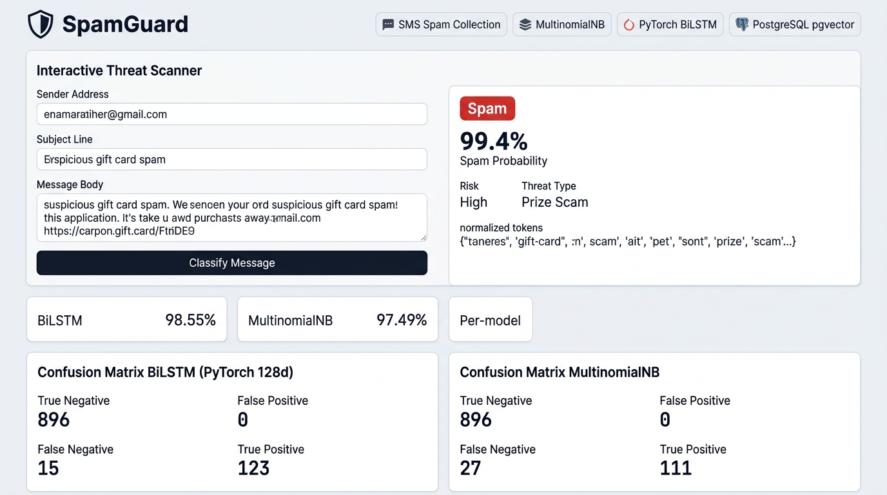
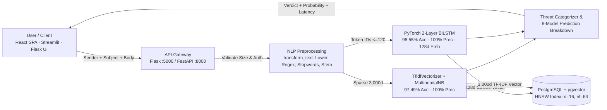

# Link: https://spam-guard-email-and-sms-spam-class-zeta.vercel.app/

# Email & SMS Spam Classification Platform (SpamGuard)

End-to-end hybrid NLP & deep learning threat-screening platform combining **TF-IDF + Multinomial Naive Bayes**, a **PyTorch 2-Layer Bidirectional LSTM (`128d` embeddings)**, **PostgreSQL + `pgvector` HNSW similarity search**, and multi-surface interfaces (**React + Vite SPA**, **Flask**, **FastAPI**, and **Streamlit**).

> **Presentation Deck:** [`docs/Email_Spam_Classification_Platform.pptx`](docs/Email_Spam_Classification_Platform.pptx) (8-slide overview of architecture, preprocessing, PyTorch BiLSTM, 8-model benchmarks, `pgvector`, and deployment).

---

## Sample Screenshot



*Interactive Threat Scanner displaying spam probability, threat categorization, per-model prediction comparison (`BiLSTM 98.55%` & `MultinomialNB 97.49%`), and side-by-side confusion matrices (`0 False Positives` across `1,034` validation messages).*

---

## Tech Stack, Databases & Frameworks Used

| Layer | Technologies & Frameworks | Purpose in Platform |
| :--- | :--- | :--- |
| **Language & Runtime** | Python 3.10+, TypeScript 7, Node.js | ML training, REST services, diagnostic engine, and frontend SPA |
| **Machine Learning** | `scikit-learn` (`MultinomialNB`, `SVC`, `RandomForest`, `BernoulliNB`, `LogisticRegression`, `GaussianNB`), `XGBoost` | Classical TF-IDF spam classification & 7-model benchmarking |
| **Deep Learning** | **PyTorch** (`SpamBiLSTM`: 2-layer BiLSTM + Masked Mean/Max Pooling + GELU MLP) | Sequence context modeling & `128d` L2-normalized semantic embeddings |
| **NLP & Data Science** | `NLTK` (Stopwords, PorterStemmer), `pandas`, `numpy`, `matplotlib`, `seaborn` | Text normalization (`transform_text()`), deduplication, EDA plots |
| **Database & Vector Index** | **PostgreSQL + `pgvector`** (`psycopg2-binary`, HNSW cosine index `<=>`) | Persisting `VECTOR(3000)` TF-IDF, `VECTOR(128)` BiLSTM vectors, & JSONB benchmarks |
| **Backend Web Frameworks** | **Flask 3** (`gunicorn`), **FastAPI** (`uvicorn`, `Pydantic`) | High-throughput REST endpoints (`/predict`, `/predict/lstm`, `/predict/batch`), Swagger `/docs` |
| **Frontend & Dashboards** | **React 19**, **Vite 8**, **Tailwind CSS v4**, `lucide-react`, **Streamlit** | Real-time threat console, CSV export, benchmark charts, & live API toggle |
| **Deployment & Security** | Vercel (Vite SPA), Render Blueprint (`render.yaml`), Docker Compose | Isolated frontend/API hosting, `ADMIN_API_TOKEN`, `PGSSLMODE=require`, allowlist CORS |

---

## How It Was Built (Repository Structure & Phases)

```text
.
├── api/
│   ├── app.py                  # Hardened Flask REST API (:5000) + Jinja HTML console
│   ├── fastapi_app.py          # Typed FastAPI OpenAPI service (:8000 /docs)
│   └── templates/index.html    # Server-rendered Flask web UI
├── db/
│   ├── schema.sql              # classification_logs + model_benchmarks + pgvector DDL
│   └── migrations/             # Incremental HNSW index up/down SQL migrations
├── docs/
│   ├── sample-screenshot.jpg   # UI sample screenshot
│   └── Email_Spam_Classification_Platform.pptx  # 8-slide project & model deck
├── notebooks/                  # Jupyter exploration & training notebook
├── src/
│   ├── eda.py                  # Phase 1: Deduplication (5,572 -> 5,169) & EDA charts
│   ├── preprocess.py           # Phase 2: transform_text() & rule-based threat classifier
│   ├── train.py                # Phase 3: TF-IDF (3,000) & 7 classical ML benchmarks
│   ├── verify_artifacts.py     # Phase 3b: Pickle integrity & inference sanity checks
│   ├── lstm_model.py           # Phase 4: SpamBiLSTM network & LstmSpamPredictor
│   ├── train_lstm.py           # Phase 4b: 18-epoch training & precision threshold calibration
│   ├── db.py                   # Phase 5: Threaded PostgreSQL + pgvector persistence
│   ├── threat_analyzer.py      # Unified Python payload analyzer & 8-model predictions
│   ├── nlpEngine.py            # Zero-dependency pure-Python diagnostic mirror
│   └── App.tsx                 # React 19 Threat Console & Benchmark Dashboard
├── streamlit_app.py            # Multi-tab Streamlit ML workbench
├── docker-compose.yml          # Local PostgreSQL pgvector + Flask + FastAPI + Streamlit
├── render.yaml                 # Render PaaS multi-service deployment blueprint
├── vercel.json / .vercelignore # Vite SPA deployment config for Vercel
└── requirements.txt / package.json
```

### Build & Modeling Phases
1. **Phase 1 — EDA & Deduplication (`src/eda.py`)**: Loads the `5,572`-record SMS Spam Collection, removes `403` duplicates (`5,169` unique messages: `87.37%` Ham / `12.63%` Spam), and exports `artifacts/class_distribution.png` & `artifacts/top_words.png`.
2. **Phase 2 — Text Normalization (`src/preprocess.py`)**: `transform_text()` applies lowercasing, regex URL/symbol stripping, NLTK stop-word removal, and Porter Stemming, paired with `classify_threat_type()` (`Prize Scam`, `Credential Phishing`, `Financial Fraud`, `Urgency Spam`).
3. **Phase 3 — TF-IDF & Classical ML (`src/train.py`, `src/verify_artifacts.py`)**: Fits `TfidfVectorizer(max_features=3000)` on a stratified `80/20` split (`4,135` train / `1,034` validation) and benchmarks 7 classifiers. `MultinomialNB` hits `100.00%` precision (`0` false positives) at `97.49%` accuracy and serializes `vectorizer.pkl` + `model.pkl`.
4. **Phase 4 — PyTorch BiLSTM (`src/lstm_model.py`, `src/train_lstm.py`)**: Trains a 2-layer Bidirectional LSTM with masked mean+max pooling, `LayerNorm`, GELU projection (`128d` normalized embeddings), `CosineAnnealingLR`, and threshold calibration—achieving **`98.55%` Accuracy**, **`100.00%` Precision (`0` FP)**, and **`89.13%` Recall** (`lstm_model.pt`, `lstm_vocab.pkl`).
5. **Phase 5 — PostgreSQL + `pgvector` (`db/schema.sql`, `db/migrations/`, `src/db.py`)**: Stores predictions, `VECTOR(3000)` TF-IDF vectors, and `VECTOR(128)` BiLSTM embeddings indexed via **HNSW (`m=16`, `ef_construction=64`, `vector_cosine_ops`)** for fast `<=>` similarity search.
6. **Phase 6 — Multi-Surface UI & Public Security (`api/`, `src/App.tsx`, `streamlit_app.py`)**: Exposes hardened REST and browser interfaces with `ADMIN_API_TOKEN` gating, `ENABLE_PUBLIC_HISTORY=false` privacy defaults, input bounds (`20,000` chars / `100` batch limit), security headers, and allowlist CORS.

---

## Architecture & Data Flow Diagram



```text
[Client Input] -> [transform_text()] -> +--[TF-IDF (3000d) + MultinomialNB]--+--> [Verdict & Threat Type]
                                        +--[Token Seq + PyTorch BiLSTM (128d)]-+        |
                                                       |                                v
                                                       +--> [PostgreSQL pgvector HNSW] <+
```

---

## Model Benchmark Summary (`1,034` Validation Messages)

| Model | Accuracy | Precision | Recall | F1 |
| :--- | :---: | :---: | :---: | :---: |
| **BiLSTM (PyTorch 128d) — Primary** | **98.55%** | **100.00%** | **89.13%** | **94.25%** |
| SVC (Sigmoid) | 97.58% | 97.48% | 84.06% | 90.27% |
| **MultinomialNB (TF-IDF Baseline)** | **97.49%** | **100.00%** | **80.43%** | **89.16%** |
| RandomForest (50) | 97.49% | 98.28% | 82.61% | 89.76% |
| BernoulliNB | 97.00% | 97.35% | 79.71% | 87.65% |
| XGBoost (50) | 96.71% | 94.83% | 79.71% | 86.61% |
| LogisticRegression (L1) | 95.84% | 97.03% | 71.01% | 82.01% |
| GaussianNB | 86.94% | 49.56% | 81.88% | 61.75% |

---

## Local Setup & Training

### 1. Install Dependencies
```bash
python -m venv .venv
source .venv/bin/activate
pip install -r requirements.txt
```

### 2. Configure PostgreSQL + `pgvector`
```bash
createdb spam_classifier
psql -d spam_classifier -f db/schema.sql
# Or run incremental HNSW index migration on an existing database:
psql -d spam_classifier -f db/migrations/001_add_lstm_embedding_hnsw_index.sql
cp .env.example .env
# Edit .env with PGHOST, PGPORT, PGDATABASE, PGUSER, PGPASSWORD, PGSSLMODE,
# ADMIN_API_TOKEN, ENABLE_PUBLIC_HISTORY ("false" for public deployments), and ALLOWED_ORIGINS
```

### 3. Train & Serialize Both Models
```bash
# Train 7 classical ML classifiers + serialize vectorizer.pkl & model.pkl
python -m src.train
python -m src.verify_artifacts

# Train PyTorch BiLSTM + serialize lstm_model.pt & lstm_vocab.pkl
python -m src.train_lstm
```

### 4. Run Flask API, FastAPI Service & Streamlit UI
```bash
# Flask REST API (port 5000)
gunicorn -w 2 -b 0.0.0.0:5000 api.app:app

# FastAPI OpenAPI service (port 8000, Swagger UI at /docs)
uvicorn api.fastapi_app:app --host 0.0.0.0 --port 8000

# Streamlit Web App (port 8501)
streamlit run streamlit_app.py
```

### Example `POST /predict` Request (Flask or FastAPI)
```bash
curl -X POST http://localhost:5000/predict \
  -H "Content-Type: application/json" \
  -d '{"text": "URGENT! You have won a FREE $1,000 gift card. Claim now!", "model": "mnb"}'
```

---

## Deployment

### Option A: Docker Compose (PostgreSQL + pgvector + Flask + FastAPI + Streamlit)
```bash
docker compose up --build -d
```
- **Flask REST API**: `http://localhost:5000`
- **FastAPI + Swagger Docs**: `http://localhost:8000/docs`
- **Streamlit UI**: `http://localhost:8501`
- **PostgreSQL + pgvector**: `127.0.0.1:5432`

### Option B: Render / PaaS Blueprint (`render.yaml`, `Procfile`)
- Use `render.yaml` to deploy separate Flask (`gunicorn`), FastAPI (`uvicorn`), and Streamlit services pointing to your managed PostgreSQL (`pgvector`) instance.

### Option C: Streamlit Community Cloud
- Set main file to `streamlit_app.py` and configure `PGHOST`, `PGPORT`, `PGDATABASE`, `PGUSER`, `PGPASSWORD`, and optional `FLASK_API_URL` in Streamlit Secrets.

### Option D: Vercel (`https://spam-classifierx.vercel.app/`)
`vercel.json` and `.vercelignore` are preconfigured for a clean Vite deployment without bundling heavy PyTorch/scikit-learn server dependencies:
```bash
npm i -g vercel
vercel login
vercel link --project spam-classifierx
vercel --prod
```
- Run `vercel --prod` (or push to your connected GitHub `main` branch) from this exported project folder so a **Production** deployment is active; visiting the URL before a Production build succeeds returns `404 DEPLOYMENT_NOT_FOUND`.
- Verify the exact project domain under **Vercel Dashboard → Project Settings → Domains** is `spam-classifierx.vercel.app`, with **Framework Preset: Vite**, **Build Command:** `npm run build`, and **Output Directory:** `dist`.
- Connect the **Flask / FastAPI REST** toggle in the UI to your Render/Docker backend URL when running full PyTorch BiLSTM + PostgreSQL `pgvector` logging.
